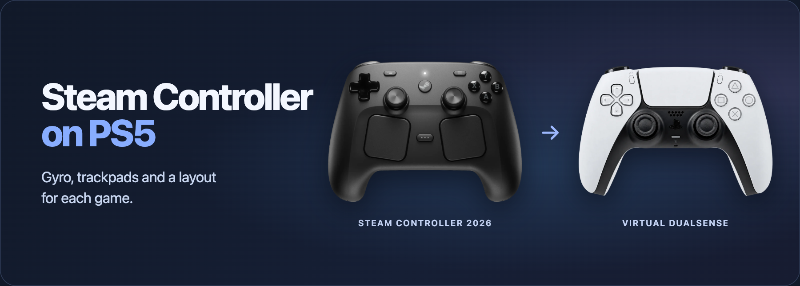
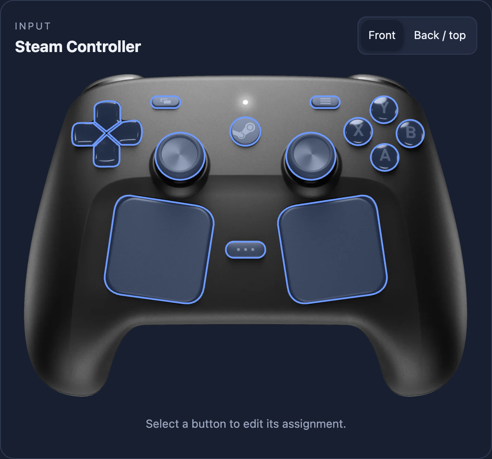
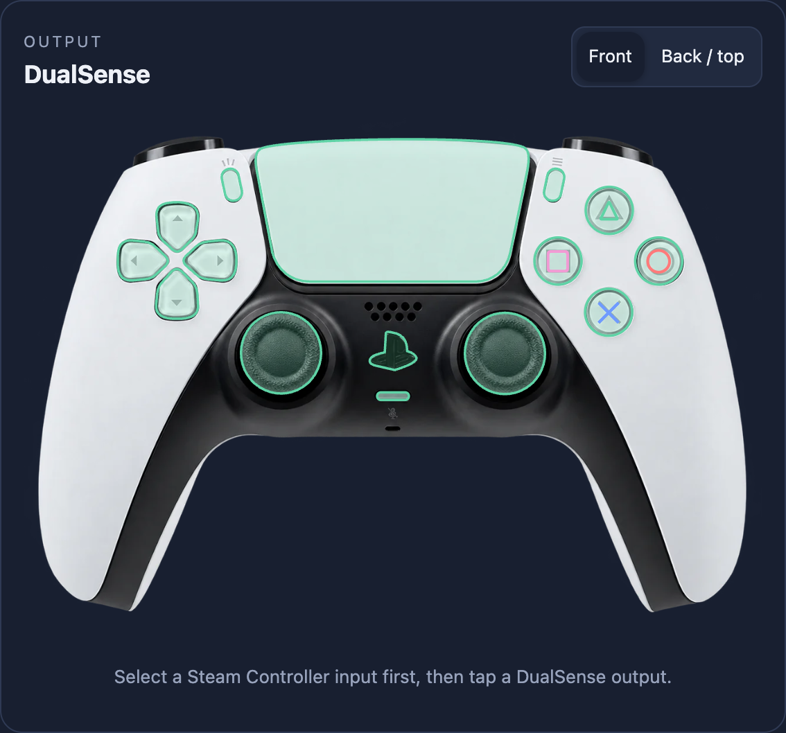
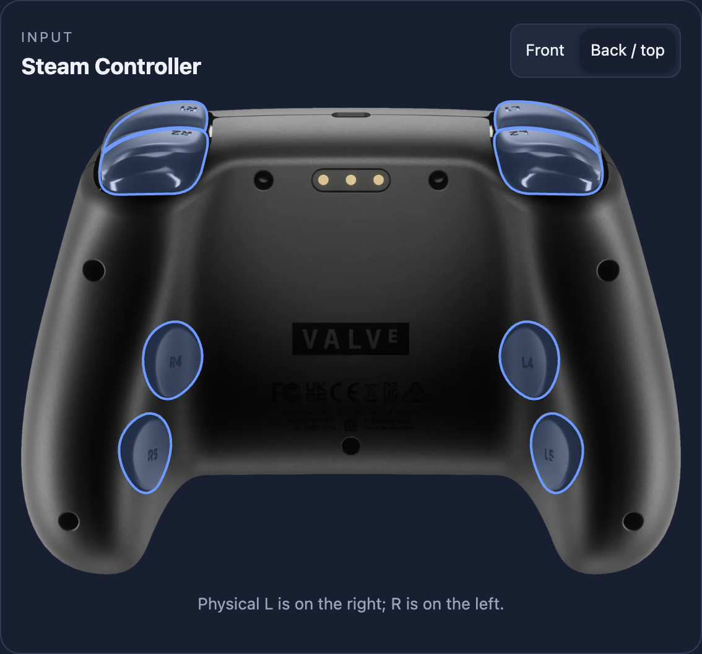
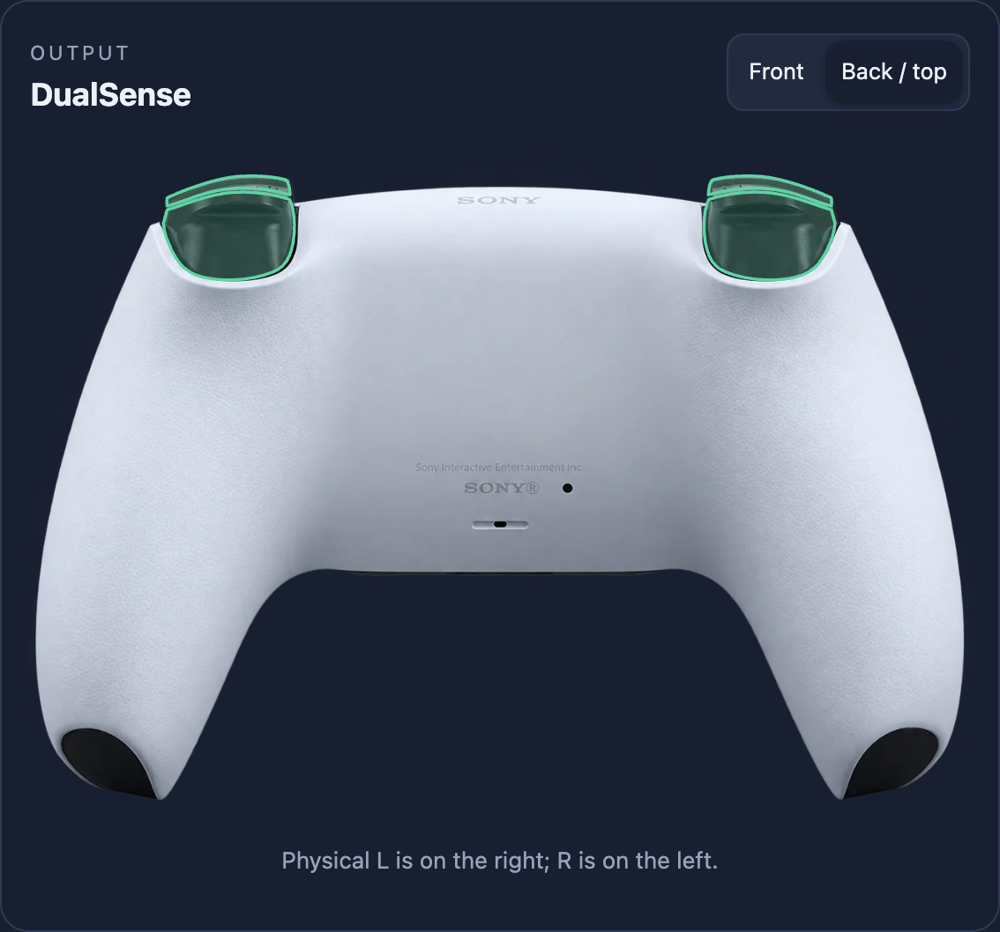

<div align="center">

# SteamController-PS5



[](https://github.com/MNeroba/SteamController-PS5/releases/tag/dev/v1.6.3-experimental)
[](#quick-start)
[](LICENSE)

[](https://github.com/MNeroba/SteamController-PS5/actions/workflows/host-tests.yml)
[](https://github.com/MNeroba/SteamController-PS5/actions/workflows/ps5-cross-build.yml)
[](docs/BUILDING.md)

[Quick start](#quick-start) · [Controller gallery](#visual-remapping) · [Build from source](#build-from-source) · [Documentation](docs/README.md)

</div>

> [!IMPORTANT]
> **Experimental PS5 homebrew.** The project has passed host tests and PS5 cross-builds. Physical console validation is pending. Firmware **13.60** is the intended test target and compatibility is unverified. Running the ELF requires an independently confirmed compatible development loader.

## Make the controller yours

One native payload takes input from one **Steam Controller 2026** over USB-C or the official Valve Puck and maps it to a regular virtual DualSense. The settings editor runs on the console and gives each game its own layout.

| **Buttons that do more** | **Gyro and Flick Stick** |
| --- | --- |
| Put all four rear buttons to work. Give a button a combo, a long press, a double press, or a second job on a Shift layer. | Aim with gyro and use the right stick to turn quickly with Flick Stick. Tune motion and stick response per profile. |
| **Two trackpads, two jobs** | **Profiles you can take with you** |
| Set either pad to touchpad, stick, or D-pad mode. Assign each pad click independently. | Keep a default layout, customize individual games, and import or export profiles as files. Preview assignments before saving. |

**Game feedback** uses classic PS4-style rumble automatically when the virtual pad exposes it. PS5-native haptics use opt-in experimental game hooks, which are off by default. Trigger effects can translate into vibration. Use **Vibration test** to check feedback from the controller itself. [Feedback and setup details](docs/development/LOADING.md#safe-defaults-and-in-game-feedback)

## Visual remapping

Pick a Steam input, choose one or more DualSense outputs, then confirm the assignment. The rear views put the bumpers, triggers and Steam rear buttons on the same screen. Physical **L is on the right** and **R on the left** in those views.

| Steam Controller | DualSense |
| --- | --- |
|  |  |
|  |  |

The host preview shows the current source with every outline visible for inspection. [Remapping overview](docs/images/remap/overview.png) · [Binding editor](docs/images/remap/editor.png) · [Editor guide](docs/WEBUI_REMAP.md)

## Quick start

1. Download the current experimental ELF and its matching checksum. [ELF](https://github.com/MNeroba/SteamController-PS5/releases/download/dev/v1.6.3-experimental/SteamController-PS5-v1.6.3-experimental.elf) · [SHA-256 file](https://github.com/MNeroba/SteamController-PS5/releases/download/dev/v1.6.3-experimental/SteamController-PS5-v1.6.3-experimental.elf.sha256)
2. Verify the checksum, keep your native DualSense handy, and load the ELF with your compatible development loader. [Loading guide](docs/development/LOADING.md)
3. Connect your Steam Controller over USB-C or through the official Puck. On first launch, the payload attempts to add **Steam Controller Settings** to PS5 Media. Open it while the payload is running. The editor opens on the PS5 without a pairing code.

### Edit from your phone

With your PS5 and phone on the same trusted home network, open **On phone → Enable phone access** in the WebUI. Scan the QR code or enter the displayed IP address and port, then enter the one-time code from the console. On your phone, select an existing profile and choose **Save changes**. The payload reloads the active profile without a restart.

Phone access starts off, lasts up to one hour and can be ended from **On phone → Turn off**. The code is valid for five minutes and one use. Phone access uses local HTTP and is limited to existing profile edits. [Phone setup and limits](docs/development/LOADING.md#edit-from-your-phone)

For troubleshooting, open **Settings & help → Diagnostics** to copy or download a report with build, USB and virtual-controller status. Review the report before sharing it. [Report a problem](.github/ISSUE_TEMPLATE/bug_report.yml)

## How it fits together

**USB-C or Puck → Steam input engine → profile mapping → virtual DualSense**

The USB layer owns device I/O. The shared input model keeps Steam-specific motion, touch and rear-button data available to the mapper. One slot manager owns the virtual pad and neutralizes stale input. The ELF embeds the WebUI, controller artwork and Media tile assets. The WebUI saves profiles atomically and confirms writes by reading them back. [Architecture](docs/ARCHITECTURE.md)

The test suite covers the protocol, controller lifecycle, profile storage and the remapping interface in Chromium. Console validation focuses on both transports, native DualSense coexistence, gameplay, motion and feedback. Native Bluetooth LE and cross-transport identity are research tracks. [Hardware matrix](project-memory/HARDWARE_MATRIX.md) · [BLE research](docs/research/BLE_IDENTITY_PLATFORM_2026-11-28.md)

## Build from source

Set up LLVM 18 and the community PS5 Payload SDK v0.43. The payload build produces `payload/ghost-control-ps5.elf`. [Build and verification guide](docs/BUILDING.md)

```sh
make -C tests test
make -C payload
```

[Changelog](CHANGELOG.md) · [Contributing](CONTRIBUTING.md) · [Security](SECURITY.md)

## Credits and license

The project builds on **PuckbridgePS5** by ThisIsAkill and the inherited work of **Ghostcontrol** (StonedModder) and **PoorDS4** (ItsBlurf). Thanks to **TheBrokenG0d** for hardware investigation and WebUI fixes, the **PS5 Payload SDK** maintainers for the community toolchain, **Xelu** for the controller prompts, and **Akhil Moola** for the inherited controller drawing. **OmniPad-PS5** and **LibrePadPS5** informed the engineering review. [Upstream credits and source pins](docs/PROVENANCE.md) · [Contributor PR](https://github.com/MNeroba/SteamController-PS5/pull/8)

Code is **GPL-3.0-or-later**. The supplied controller photos and tile artwork have separate publication terms. Steam, PlayStation and DualSense are trademarks of their respective owners. [License](LICENSE) · [Controller artwork](payload/web/controllers/NOTICE.md) · [Tile artwork](payload/settings-tile/NOTICE.md)
