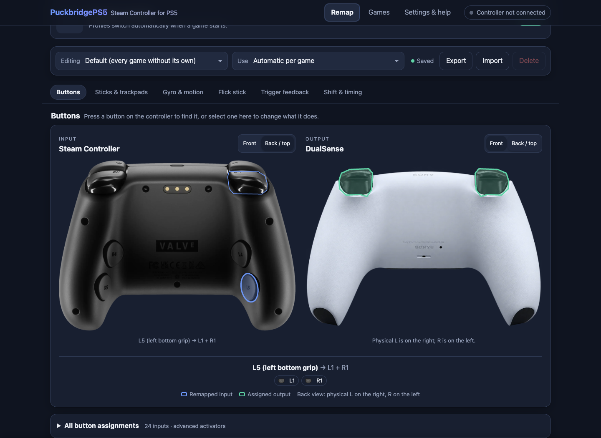
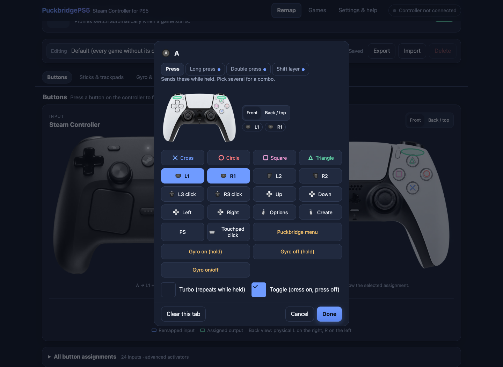

<div align="center">

# SteamController-PS5

**Steam Controller 2026 → virtual DualSense on PS5**<br>
USB-C & Valve Puck · visual remapping · gyro · trackpads · haptics

[Download dev.3](https://github.com/MNeroba/SteamController-PS5/releases/tag/dev/v0.1.0-dev.3) · [Get started](docs/development/LOADING.md) · [Build](docs/BUILDING.md) · [Changelog](CHANGELOG.md) · [Contribute](CONTRIBUTING.md)

[](https://github.com/MNeroba/SteamController-PS5/actions/workflows/host-tests.yml)
[](https://github.com/MNeroba/SteamController-PS5/actions/workflows/ps5-cross-build.yml)


</div>

> **Experimental prerelease.** Host tests and SDK builds pass; the payload has **not been tested on a physical PS5**. FW **13.60** is the intended, unverified test target. A stock console cannot load this ELF. Use an independently confirmed compatible development loader and keep your native DualSense available.

> **14 October safety update:** `main` contains fixes for ambiguous virtual-device creation, USB hotplug identity and invalid feedback status. Published dev.3 and earlier ELFs predate these fixes. A supplied dev.2/FW5.50 comment reports no input, token-storage errors and native DualSense disruption; its cause is unconfirmed. Read the [runtime review](docs/development/PUBLIC_RUNTIME_REVIEW.md) before console testing. No new binary has been published.

## Overview

One native ELF connects **one Steam Controller 2026** over USB-C or the official Valve Puck and translates its input into a virtual DualSense. The embedded WebUI lets you edit profiles and mappings without installing a separate web server or copying image assets.

The project builds on audited PuckbridgePS5 code. Steam-specific input stays in a reusable core; USB ownership, virtual-controller lifecycle and firmware-sensitive operations have separate responsibilities.

## Latest release — v0.1.0-dev.3

[Release notes and all downloads](https://github.com/MNeroba/SteamController-PS5/releases/tag/dev/v0.1.0-dev.3) · [Loading and recovery guide](docs/development/LOADING.md)

- **[SteamController-PS5-v0.1.0-dev.3.elf](https://github.com/MNeroba/SteamController-PS5/releases/download/dev/v0.1.0-dev.3/SteamController-PS5-v0.1.0-dev.3.elf)** — the only runtime binary.
- **[Matching SHA-256](https://github.com/MNeroba/SteamController-PS5/releases/download/dev/v0.1.0-dev.3/SteamController-PS5-v0.1.0-dev.3.elf.sha256)** — verify before loading.
- Payload Manager JSON, loading instructions, release notes, notices and license accompany the ELF. They are metadata/documentation, not additional payloads.

Released on **12 October 2026** from [`9aab6dbae166b28416a9a00e6346f85bf12e524e`](https://github.com/MNeroba/SteamController-PS5/tree/9aab6dbae166b28416a9a00e6346f85bf12e524e). [Release validation](https://github.com/MNeroba/SteamController-PS5/actions/runs/38225113776) passed normal host tests, ASan/UBSan, **220 Chromium assertions**, deterministic assets and a clean **SDK v0.43 / LLVM 18** build.

Dev.3 adds owned virtual-controller recovery after confirmed logout/login, authenticated diagnostic downloads, USB completion hardening, clearer connection messages and an optional PS5 Settings tile. These changes are tested on the host; their console behavior is unverified. [Full changelog →](CHANGELOG.md)

## Features and verification

| Capability | Software evidence | PS5 hardware status |
| --- | --- | --- |
| USB-C and official Valve Puck | Checked device/interface selection, protocol parsing, transfer ownership and cleanup tests | Not tested |
| Virtual DualSense | Generation-aware ownership, neutralization and logout/login recovery tests | Registration and user assignment unverified |
| Buttons, sticks, triggers and four back buttons | Remapping, Shift, Long/Double press, Turbo/Toggle and profile tests | Gameplay unverified |
| Gyro, motion, trackpads and Flick Stick | Portable mapping, calibration and motion tests | Sensor orientation, feel and game behavior unverified |
| Haptics and trigger-effect translation | Feedback encoding, queue and ownership tests | Output routing and physical feedback unverified |
| Default/per-game profiles and visual editor | Atomic persistence, import/export and browser regression tests | Console storage and live integration unverified |
| Diagnostics | Authenticated, bounded text export with filtered application logs | PS5/browser download unverified |
| Optional Settings tile | Embedded icon, ownership/authentication and installer-stub tests | Registration and launch unverified |

**Scope:** one active Steam Controller 2026, regular virtual DualSense. Native PS5 Bluetooth LE, Edge emulation, custom ShellUI controller identity and multiple active Steam Controllers remain research or unsupported. USB/Puck is independent of those research tracks. Haptic translation does not provide physical adaptive-trigger resistance.

[Detailed feature status](STEAM_CONTROLLER_2026.md) · [Hardware matrix](project-memory/HARDWARE_MATRIX.md) · [Test plan](docs/TEST_PLAN.md)

## Load and configure

This is an **ELF payload, not a PKG/FPKG or boot service**. Loader compatibility on FW 13.60 has not been established by this project. Read [the full loading guide](docs/development/LOADING.md) before a controlled development-console test.

1. Download the ELF and checksum from the **same release**; verify the checksum.
2. Load the verified ELF through your independently confirmed compatible loader.
3. Open **`http://<PS5-IP>:8090`** from a PC or phone on the same trusted LAN.
4. Enter the **eight-digit code from the local PS5 notification** to pair that browser.
5. Edit a profile and **Save**; the UI confirms stored values with a fresh readback.

A missing policy file enables the authenticated WebUI automatically. No FTP or manual INI is needed for the normal flow. Explicit `ENABLE_WEBUI=0` is respected; unsafe or malformed existing configuration fails closed. Game hooks, bridge probing and DualSense handoff stay disabled by default. Native BLE is not enabled.

Pairing codes expire after five minutes, allow five attempts and one redemption. Protected APIs use bearer authentication. **HTTP is plaintext: use a trusted isolated LAN and never expose port 8090 to the internet.** Storage remains under `/data/ghostpad` for compatibility. Advanced token recovery and shutdown procedures are in the loading guide.

### Optional settings tile — same ELF

After pairing, choose **Settings & help → PS5 tile → Create tile on PS5**, read the warning and confirm. The installer is embedded in the same ELF and creates the **Steam Controller Settings** Media tile with the supplied icon. It is never installed automatically.

The tile opens `http://127.0.0.1:8090/` while the payload is running; it **does not start the payload after reboot**. The console browser needs its own enrollment. Registration, visibility, navigation and removal are still untested on PS5. [Setup, failure handling and removal →](docs/development/SETTINGS_TILE.md)

### Troubleshooting

In **Settings & help → Diagnostics**, select **Download Diagnostic Report**. The report includes build identity, runtime firmware when available, startup stages, USB/virtual-controller state and a bounded filtered log tail. It remains useful with no controller connected.

Review the report before sharing it: profile names or USB paths may need further redaction. Never post pairing codes, bearer tokens, console identifiers or bonding keys. Use the [bug-report template](https://github.com/MNeroba/SteamController-PS5/issues/new?template=bug_report.yml) for ordinary failures and [SECURITY.md](SECURITY.md) for vulnerabilities.

## Visual remapping

Select a Steam input, choose DualSense outputs, and stage changes before saving. Front/back views cover stick clicks, grip buttons and trackpad clicks. In the back view, physical **L is on the right**, **R on the left**.

| Back controls | Binding editor |
| --- | --- |
|  |  |

These screenshots come from the real **host fixture**, not a PS5 session; they illustrate remapping rather than current release Settings screens. [Editor behavior and verification →](docs/WEBUI_REMAP.md)

## Build from source

Requirements: Python 3, make, host Clang, **LLVM 18** and community **PS5 Payload SDK v0.43**. Node 24 and Playwright are needed only for browser checks. No proprietary Sony SDK is used.

```sh
git clone https://github.com/MNeroba/SteamController-PS5.git
cd SteamController-PS5
# To rebuild the published version:
git checkout dev/v0.1.0-dev.3
# Install the pinned SDK and export PS5_PAYLOAD_SDK/LLVM_CONFIG
# using docs/BUILDING.md, then:
make -C tests clean test
make -C tests sanitize
make -C payload clean
make -C payload
```

Output: `payload/ghost-control-ps5.elf` (retained internal filename). WebUI, controller images and optional tile assets are embedded automatically. Generated headers and build output are not committed. [Linux/macOS setup, browser checks and source identity →](docs/BUILDING.md)

## Project layout

```text
payload/          PS5 adapter, Steam core, USB, profiles, embedded WebUI
  web/            Browser UI, controller artwork and button prompts
  settings-tile/  Embedded optional launcher metadata and icon
config/payload/   Payload Manager metadata source
scripts/          Release, build and validation helpers
tests/            Portable C, fault-injection and browser regressions
docs/             Architecture, setup, evidence and release procedures
project-memory/   Current status, decisions and append-only test history
.github/          CI, release workflows and contribution templates
```

Transport owns I/O; the Steam decoder owns device details; mapping is independent of the PS5 ABI. Firmware-sensitive hooks are isolated. [Architecture →](docs/ARCHITECTURE.md)

## Progress and roadmap

- **Delivered:** audited foundation, host runtime hardening, reusable protocol/session/slot modules, mapping/profiles, embedded WebUI and experimental dev.1–dev.3 releases.
- **Next:** measure actual firmware and validate USB-C/Puck, native DualSense coexistence, user recovery, game input, motion/touch/feedback, storage and shutdown on a physical console.
- **Stable release:** blocked until the required hardware evidence matches the tested source. A passing SDK build does not establish firmware compatibility.
- **Research:** passive native BLE feasibility, stable cross-transport identity and advanced platform integration. Active stock-radio experiments require separate approval.

[Current status](project-memory/CURRENT_STATUS.md) · [Documentation index](docs/README.md) · [Changelog](CHANGELOG.md)

## Contributing and security

External contributions use focused pull requests against `main`. Read [CONTRIBUTING.md](CONTRIBUTING.md), include a reproducible regression and actual checks, mark unavailable tests `NOT_RUN`, and record provenance before importing code or assets. Significant protocol, architecture or platform changes should be discussed in an issue first.

[Report a bug](https://github.com/MNeroba/SteamController-PS5/issues/new?template=bug_report.yml) · [Propose an improvement](https://github.com/MNeroba/SteamController-PS5/issues/new?template=feature_request.yml) · [Security policy](SECURITY.md)

## Credits and license

Thanks to the authors whose work made this project possible:

- **[PuckbridgePS5](https://github.com/ThisIsAkill/PuckbridgePS5)** — the audited implementation foundation, by ThisIsAkill.
- **[Ghostcontrol](https://github.com/srbraboo/Ghostcontrol-PS5-USB-Controller-Patcher)** and **[PoorDS4](https://github.com/ItsBlurf/PoorDS4)** — inherited PS5 integration and bridge work, credited to StonedModder and ItsBlurf.
- **[PS5 Payload SDK](https://github.com/ps5-payload-dev/sdk)** — community toolchain and API references.
- **[OmniPad-PS5](https://github.com/diegobarbosaa/OmniPad-PS5)** and **[LibrePadPS5](https://github.com/arwebSE/LibrePadPS5)** — reviewed engineering references; no implementation copied from these projects.
- **Xelu** — CC0 controller prompts; **Akhil Moola** — the inherited controller drawing credit. Protocol and platform references are listed with exact pins in [sources](docs/SOURCES_AND_EVIDENCE.md).

Code is **GPL-3.0-or-later**, with upstream notices retained. Supplied controller photos and the tile icon have owner-authorized publication terms; **no separate open artwork license was supplied**. The code license does not grant a new license for those assets. See [LICENSE](LICENSE), [provenance](docs/PROVENANCE.md), [controller artwork notice](payload/web/controllers/NOTICE.md), [tile artwork notice](payload/settings-tile/NOTICE.md) and [upstream documents](docs/archive/upstream/README.md).

Not affiliated with Valve or Sony. Steam, PlayStation and DualSense are their respective owners' trademarks.
