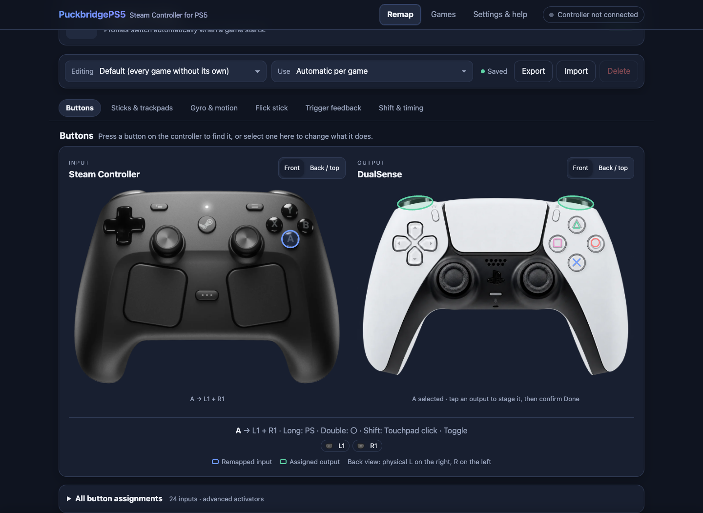
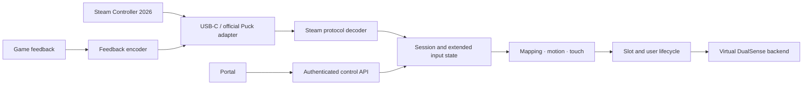

# SteamController-PS5

<p align="center">
  <strong>Use the Steam Controller 2026 as a virtual DualSense on PS5.</strong><br>
  USB-C and the official Valve Puck are the primary targets.
</p>

<p align="center">
  <a href="LICENSE"></a>
  
  
  
</p>

> **Development project — not a verified release.** The source has passed portable host tests and a PS5 SDK cross-build. The owner reports a PS5 on firmware 12.00; no console, Steam Controller, DualSense, or Puck runtime test has been performed. Firmware compatibility and gameplay support are therefore **not claimed**.

SteamController-PS5 is a focused payload project for carrying Steam Controller input into the PS5 controller stack. It builds on the Steam USB/Puck and virtual-controller work in PuckbridgePS5, while extracting reusable protocol, mapping, motion, session, and lifecycle code for independent host testing.

## Project status

| Area | Progress | What the evidence says |
|---|---|---|
| **M0 · foundation and licensing** | Complete | PuckbridgePS5 was selected after a pinned source comparison with OmniPad-PS5. See [ADR-001](docs/BASE_SELECTION_ADR.md) and [provenance](docs/PROVENANCE.md). |
| **P0 · safety and architecture** | Host-hardened; target verification pending | Host-tested input parsing, exact authenticated portal routes, bounded requests, local IPv4 peer filtering, session/slot lifecycle, privilege rollback, safe defaults, and concurrency fixes are present. PS5 adapter and runtime behavior still need target testing. |
| **M1 · USB-C and official Puck** | Partial | Discovery admits only Valve's Steam Controller 2026 wired/Puck VID:PID pairs. USBFS is initialized only after a valid configuration map identifies HID interrupt-IN interfaces; unavailable or malformed descriptors fail closed. Live USB/Puck enumeration and reconnect behavior remain unverified. |
| **M2 · Steam controls and motion** | Partial | Input, mapping, motion, touch, profiles, and extra-control paths exist in source; end-to-end behavior on a console and controller is unverified. |
| **M3 · haptics and feedback** | Partial | A generation-tagged lease admits one active SC2 USB/Puck reader, rejects a second SC2 reader, and gates queue service and teardown by owner token. Host tests cover the policy; `gc_main.c`, USB output and physical haptics remain target-unverified. Multi-SC2 use is not supported. |
| **M4 · native PS5 Bluetooth LE** | Research only | No native PS5 GAP/GATT path is proven. No HCI or radio operation has been run. See [BLE decision](docs/BLE_DECISION.md). |
| **M5 · Edge identity and ShellUI** | Research backlog | Separate experiments; not part of the verified DualSense path. |
| **M6 · portal and diagnostics** | Partial | Token authentication, strict route/query parsing, bounded request framing, absolute request/response deadlines, and diagnostics have host tests. The portal uses plain HTTP and has not been validated on-console. |

Evidence labels used in the project: `VERIFIED_CODE`, `VERIFIED_HOST_TEST`, `VERIFIED_PS5_BUILD`, `VERIFIED_HARDWARE`, `UPSTREAM_CLAIM`, `EXTERNAL_HARDWARE`, `HYPOTHESIS`, and `BLOCKED`. A cross-build is not a runtime or hardware test. See the [test plan](docs/TEST_PLAN.md) and [hardware matrix](project-memory/HARDWARE_MATRIX.md) for detail.

For a per-feature view of what exists in source, what has host coverage, and what still needs console evidence, see [Steam Controller feature status](STEAM_CONTROLLER_2026.md).

## Button remapping

The **Remap → Buttons** screen uses interactive Steam Controller and DualSense images, front/back views, calibrated L1/R1 and face-button hotspots, 24 inputs, 18 digital outputs, combo highlights and the existing game-profile editor. The local browser fixture passes 181 checks, including hostile imports, production C profile normalization, Save/readback failures and concurrent edits, full SVG geometry sampling, mobile scrolling, keyboard and touch. Profiles now reject truncation/corruption, preserve drafts across navigation and route analog triggers from effective bindings. Imported IDs are validated before rendering; Shift triggers suppress Full pull and Turbo/Toggle conflicts normalize consistently. [Host Actions](https://github.com/MNeroba/SteamController-PS5/actions/runs/38070068676) passes the Chromium regression alongside normal and ASan/UBSan suites. The [SDK cross-build](https://github.com/MNeroba/SteamController-PS5/actions/runs/38070068771) passes. Operation on a real PS5 remains unverified.



[UI guide, screenshots and reproducible checks](docs/WEBUI_REMAP.md)

## Default runtime safety mode

At startup, the payload reads the optional local file
`/data/ghostpad/runtime-policy.ini`. If it is missing, malformed, oversized,
or a symlink, every optional service stays disabled. Safe defaults disable
game-memory bridge probing, game hooks, DualSense hand-off, and the WebUI.
USB discovery accepts only the Steam Controller 2026 wired/Puck VID:PID pairs.
Unknown devices never enter USBFS or have interfaces detached. For a recognized
device, only unique, descriptor-mapped HID interfaces with a valid interrupt-IN
endpoint can be detached; an unavailable or malformed configuration map fails
closed. This code-level gate does not prove PS5 driver behavior or a real device
descriptor, and target hardware testing is still required.

Tag builds run the host/sanitizer suite and PS5 cross-build. GitHub Releases are
published only after the required hardware rows H-01, H-02, H-03, H-04, H-05,
H-09, and H-12 are recorded as `VERIFIED_HARDWARE` with concrete test-log
evidence. The current matrix is blocked, so this repository has no verified
release binary.

The [PS5 cross-build workflow](https://github.com/MNeroba/SteamController-PS5/actions/workflows/ps5-cross-build.yml)
also uploads a temporary Actions artifact named `ghost-control-ps5-cross-build`
containing the ELF and its SHA-256 file. Download it from the latest successful
workflow run. Actions artifacts expire under GitHub's retention policy and are
build outputs only; they are not Releases or evidence of PS5 runtime support.

Optional services require explicit local configuration, one setting per line:

```ini
ENABLE_WEBUI=1
# ENABLE_GAME_HOOKS=1
# ENABLE_BRIDGE_PROBE=1
# ENABLE_DUALSENSE_HANDOFF=1
```

Only uncomment a setting after reviewing its effects. A WebUI request cannot
enable DualSense hand-off unless that separate policy opt-in is present.

## What it is designed to do

- Focus on **Steam Controller 2026**, rather than being a generic controller hub.
- Start with direct USB-C and the official Valve Puck.
- Preserve Steam-specific motion, touch, rear controls, and feedback in the input model, even where the PS5 output path cannot expose every capability.
- Use a shared controller/session architecture and the normal virtual DualSense path as the default output.
- Keep transport, Steam report decoding, mapping, and PS5-specific integration in separate, testable layers.

Native Bluetooth LE is a gated research track, not a supported connection method. Do not reset, claim, or take over the PS5's internal Bluetooth radio. Do not risk the stock DualSense to test speculative APIs.

## Architecture



The boundaries and ownership rules are documented in [Architecture](docs/ARCHITECTURE.md). The active code is still a staged derivative; this diagram describes the target architecture and is not a claim that every connection is complete.

## Build and test

### Portable host tests

The host test suite does not need the PS5 SDK:

```sh
make -C tests clean test
make -C tests clean sanitize
```

The latest full normal and AddressSanitizer/UndefinedBehaviorSanitizer suites pass. Coverage includes injected USB scanner operations, multiplexed endpoint completion, cleanup retries, strict SC2 interface authorization, credential rollback, process-instance locking, safe-mode defaults, and release evidence validation. The suite also exercises 100,000 deterministic Steam reports and 100,000 USB descriptor inputs. Portal coverage includes bearer-token policy, exact routes, bounded request/response deadlines, same-host `Origin` checks when browsers send that header, rejection of empty or incorrectly declared profile bodies, and IPv4 peer-scope policy. Targeted ThreadSanitizer runs pass for recorded concurrency tests, including the SC2 scanner. These host tests use production portable modules and fakes; they do not emulate PS5 USB ioctls or prove console behavior. Exact commands and limits are in [`project-memory/TEST_LOG.md`](project-memory/TEST_LOG.md).

### PS5 payload cross-build

The build uses the community [ps5-payload-dev SDK](https://github.com/ps5-payload-dev/sdk) v0.43 and LLVM 18. The SDK archive is checked against SHA-256 `a9cc9929f21b2b2c5d5b309f3bab4997067c45281c0622cf4838b1aecba66fcb`. The commands below are the recorded macOS/Homebrew setup; `.build-cache/` is ignored by Git.

```sh
brew install llvm@18
export LLVM_CONFIG="$(brew --prefix llvm@18)/bin/llvm-config"

mkdir -p .build-cache/ps5-payload-sdk-v0.43
curl -fL -o .build-cache/ps5-payload-sdk-v0.43/ps5-payload-sdk.zip \
  https://github.com/ps5-payload-dev/sdk/releases/download/v0.43/ps5-payload-sdk.zip
printf '%s  %s\n' \
  a9cc9929f21b2b2c5d5b309f3bab4997067c45281c0622cf4838b1aecba66fcb \
  .build-cache/ps5-payload-sdk-v0.43/ps5-payload-sdk.zip | shasum -a 256 -c
unzip -q -o .build-cache/ps5-payload-sdk-v0.43/ps5-payload-sdk.zip \
  -d .build-cache/ps5-payload-sdk-v0.43

export PS5_PAYLOAD_SDK="$PWD/.build-cache/ps5-payload-sdk-v0.43/ps5-payload-sdk"
python3 payload/gen_html.py
make -C payload clean all
file payload/ghost-control-ps5.elf
shasum -a 256 payload/ghost-control-ps5.elf
```

The latest local build used Darwin arm64, Homebrew LLVM 18.1.8, and SDK v0.43. It produced an ELF64 x86-64 payload and linked against the expected SDK libraries. This verifies compilation and linking only. It does **not** verify firmware compatibility, loading, or operation on a PS5. More detail is in [the build record](docs/BUILDING.md).

## Load on a development console

There is no persistent installer or supported release package yet. The payload Makefile has a `deploy` target that streams the built ELF to a TCP listener; it does not install system files:

```sh
make -C payload deploy PS5_HOST=192.168.1.50 PORT=9021
```

Use this only when you have independently confirmed that your **development** console, exact firmware, and payload loader support this ELF and the loader is listening on the selected port. Port `9021` is the inherited Makefile default, not a compatibility guarantee. This project's deploy path has not been tested on a physical PS5. Do not use this as an installation recipe for a stock console or infer support for the reported FW 12.00 from upstream claims.

If the payload starts and its portal is available, it listens at `http://<PS5-IP>:8090`. The server accepts loopback, RFC1918 private, and IPv4 link-local peers only; public IPv4 peers and IPv6 are rejected. The portal token is stored at `/data/ghostpad/webui.token`; retrieve it through trusted local console access. Portal traffic is plain HTTP, so use it only on a trusted local network and never expose the port to the public internet. API requests still require the bearer token. See the P0 web-security requirements in [CODEX_TASK.md](CODEX_TASK.md) and the repository's [security issue list](project-memory/ISSUES.md).

## Repository map

| Path | Purpose |
|---|---|
| [`payload/`](payload/) | Payload, PS5 adapter, Steam protocol/mapping modules, portal and web assets |
| [`tests/`](tests/) | Portable tests, host SDK stubs, and sanitizer targets |
| [`docs/`](docs/) | Architecture, source evidence, build, licensing, BLE gates, and test plan |
| [`STEAM_CONTROLLER_2026.md`](STEAM_CONTROLLER_2026.md) | Per-feature implementation and evidence status; not an installation guide |
| [`project-memory/`](project-memory/) | Append-only findings, decisions, issues, test/session logs, and hardware matrix |
| [`CODEX_TASK.md`](CODEX_TASK.md) | Full development specification and milestones |
| [`AGENTS.md`](AGENTS.md) | Repository workflow, safety, provenance, and evidence requirements |
| [`CONTRIBUTING.md`](CONTRIBUTING.md) | External contribution and pull request requirements |
| [`.github/pull_request_template.md`](.github/pull_request_template.md) | Pull request checklist |

## Contributing

Small, reviewable contributions are welcome. Before a significant feature or architecture change, open an issue to discuss scope and evidence. Read [CONTRIBUTING.md](CONTRIBUTING.md), keep each PR focused, include the exact checks you ran, and mark unavailable hardware checks `NOT_RUN` with the reason. Preserve upstream notices and add a provenance entry before importing third-party code.

Do not submit secrets, console identifiers, Bluetooth addresses/bonding material, firmware files, confidential Sony SDK content, or unlicensed assets. Do not perform active native-radio experiments, firmware/system writes, or other irreversible console operations as part of a PR.

## Upstream work and thanks

This repository is a derivative of [PuckbridgePS5](https://github.com/ThisIsAkill/PuckbridgePS5), pinned for the foundation audit at [`78460113ef7c48502c765a1f83ba34d53c977134`](https://github.com/ThisIsAkill/PuckbridgePS5/commit/78460113ef7c48502c765a1f83ba34d53c977134). Its Steam Controller and virtual DualSense implementation made this project possible; inherited copyright and license notices are retained.

Thanks to:

- [ThisIsAkill and PuckbridgePS5 contributors](https://github.com/ThisIsAkill/PuckbridgePS5) for the Steam Controller PS5 foundation.
- [StonedModder and Ghostcontrol](https://github.com/srbraboo/Ghostcontrol-PS5-USB-Controller-Patcher) for the virtual-controller groundwork used upstream.
- [ItsBlurf and PoorDS4](https://github.com/ItsBlurf/PoorDS4); the imported bridge files carry their detailed attribution in [`payload/bridge/NOTICE.md`](payload/bridge/NOTICE.md).
- [OmniPad-PS5](https://github.com/diegobarbosaa/OmniPad-PS5) for a comparison point on slots and lifecycle design. **No OmniPad code is imported.**
- The maintainers of [SteamlessController](https://github.com/ddeverill/SteamlessController), [SDL](https://github.com/libsdl-org/SDL), Linux [`hid-steam`](https://github.com/torvalds/linux/tree/master/drivers/hid), [OpenPuck](https://github.com/safijari/openpuck), and [SteamlessLink](https://github.com/reo101/SteamlessLink) for public protocol research and references. These are references; their code is not represented as imported here.
- [ps5-payload-dev](https://github.com/ps5-payload-dev/sdk) for the community build SDK.
- Akhil Moola for the upstream portal controller illustration, and the creators of [Xelu's Free Controller Prompts](https://thoseawesomeguys.com/prompts/) for button prompt icons. See [provenance](docs/PROVENANCE.md) for asset and license notes.

The comparison and attribution register is in [`docs/PROVENANCE.md`](docs/PROVENANCE.md). OmniPad is a read-only comparison reference; no OmniPad code was imported. The project is distributed under **GPL-3.0-or-later**; see [`LICENSE`](LICENSE).

---

<p align="center"><sub>Built carefully, with evidence. Hardware compatibility will be claimed only after hardware tests.</sub></p>
